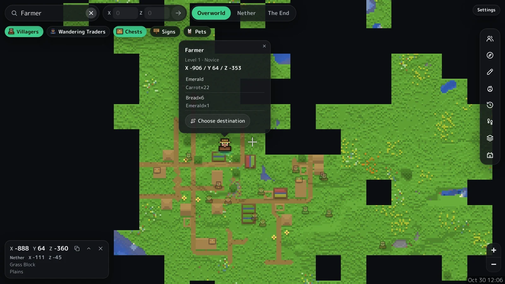

# Blockmap

[日本語](README.md)

A map of your Minecraft Bedrock Realm, in the browser. The map updates itself in the cloud; no PC needs to stay on.



- Only the Realm's members can see the map (sign in with Microsoft).
- The map and other data are stored only in your own Cloudflare account.
- Runs on the free plans of GitHub and Cloudflare.

## Features

- **Map**: Overworld, Nether and The End. Zoom in to single blocks and see coordinates, height, block and biome.
- **Players**: positions while playing (about every 20 seconds), beds, last death points and 24-hour trails.
- **Search**: coordinates, villagers (profession, level, trades), Wandering Traders, chest contents, signs, pets and biomes.
- **Drawing**: pins, text, lines, polygons, rectangles, circles and ellipses, snapped to blocks and shared with members.
- **Past maps**: go back to any saved day, or play the changes in order.
- **Overlays**: contours, slime chunks, chunk lines, Nether coordinate converter, who explored where (estimated), Nether Portal links.
- **Realms info**: server status, players online, difficulty, game rules and the next payment day.
- **Languages**: Japanese and English (game terms use the official translations).

## Requirements

- The Realm owner's Microsoft account (only the owner can download the world)
- A [GitHub](https://github.com/) account (free)
- A [Cloudflare](https://dash.cloudflare.com/sign-up) account (free)

## Setup

Takes about 30 minutes.

### 1. Create the repository

1. Select **Use this template** → **Create a new repository** at the top of this page.
2. Keep it **Public** (GitHub Actions is free for public repositories; the data is encrypted).
3. Leave **Include all branches** unchecked.

### 2. Prepare Cloudflare

1. Open **Workers & Pages** in the Cloudflare dashboard. If asked for a workers.dev subdomain, choose one. The site will be at `https://map.<subdomain>.workers.dev`.
2. Go to **My Profile** → **API Tokens** → **Create Token**.
3. Choose the **Edit Cloudflare Workers** template, add the permission **Account / D1 / Edit**, and create the token. Copy it (it is shown only once).
4. Copy the **Account ID** shown on the **Workers & Pages** page.

### 3. Add the secrets

In the new repository, go to **Settings** → **Secrets and variables** → **Actions** → **New repository secret** and add these four.

| Name | Value |
|---|---|
| `REALMS_CACHE_KEY` | About 40 random characters (from a password generator) |
| `SHARE_PASSPHRASE` | Another, different string of about 40 random characters |
| `CLOUDFLARE_API_TOKEN` | The token from step 2-3 |
| `CLOUDFLARE_ACCOUNT_ID` | The Account ID from step 2-4 |

Optionally, add these under the **Variables** tab of the same page (**New repository variable**).

| Name | Value |
|---|---|
| `LANGUAGE` | `ja` shows the messages in the Actions runs in Japanese (English if left out) |
| `TIMEZONE` | The time zone for the map's dates, e.g. `America/New_York` (`Asia/Tokyo` if left out) |
| `REALM_NAME` | Only if you own more than one Realm: the name of the one to use |

### 4. Sign in to Realms

1. Open the **Actions** tab (enable workflows the first time).
2. Select **Map site** → **Run workflow**, choose **Sign in to Realms** under **What to do** and run it.
3. Open the running **login** job and enter the code it shows at https://www.microsoft.com/link.
4. Sign in with the Realm owner's account (within 15 minutes).

### 5. Build the map

1. **Run workflow** again with **Update map**.
2. When it finishes, the run's Summary shows "Site: https://map.….workers.dev".
3. Open that address and sign in with Microsoft. The person who set it up is the admin.

From then on it updates automatically.

| What | How often |
|---|---|
| Map | Every hour (each time the world is saved while someone plays) |
| Players online and positions | Every 10 minutes (every 20 seconds while someone plays) |

## Usage

### Inviting members

1. In the **Admin menu** (the shield icon on the right), select **Copy site URL** and send it to your members.
2. Members open the address and sign in with the Microsoft account they play Minecraft with.

### Admin menu

| Item | What it does |
|---|---|
| Realm payment | Payment day, price and currency, shown in Realms info |
| Hidden from the map | Hides all chests or other players' pets (for everyone, admin included) |
| Who can edit | Members start as view only. Choose who can add pins and drawings |

## Security and privacy

- **Signing in to Realms**: Realms has no public API, so this tool uses [prismarine-auth](https://github.com/PrismarineJS/prismarine-auth) to sign in as the official Minecraft app for Nintendo Switch, a method used by many unofficial tools. Sign-in uses a code, so no password is handled. Access is limited to Xbox Live and Realms; email, OneDrive and payment details are out of reach. The sign-in is encrypted with `REALMS_CACHE_KEY` and kept only in the repository's Actions cache.
- **Signing in to the site**: used only to check the gamertag; the Microsoft token is discarded right after. The site keeps the sign-in state, the gamertag and a hashed ID.
- **Where data is stored**: the map, chests and positions are stored in Cloudflare. The `map-data` and `live-data` branches on GitHub hold them only in encrypted form.
- **Recommended**: turn on two-step verification for your Microsoft and GitHub accounts. To revoke the Realms sign-in, use **Security** → **Sign out everywhere** in your Microsoft account (then repeat step 4 to resume).
- Changes on Microsoft's side may stop the Realms download from working.

## Troubleshooting

Check the message shown in the Actions run.

| Message | Fix |
|---|---|
| Not signed in to Realms yet | Run step 4 |
| Not signed in / The sign-in has expired | Run step 4 again |
| There are 2 Realms | Add `REALM_NAME` (step 3) |
| The Cloudflare secrets are not all set | Check the four secrets from step 3 |
| Could not find the site's address | Choose a subdomain (step 2-1), then update the map again |
| The … branch cannot be opened with this key | If you changed `REALMS_CACHE_KEY`, put it back. Otherwise delete that branch (the map is rebuilt from scratch) |
| Scheduled updates stopped | GitHub may pause scheduled runs in public repositories after 60 days without activity. Re-enable them in Actions |

## How it works

```
Map site (.github/workflows/map.yml)
  download the world from Realms (tools/realms)
  → stop if nothing changed
  → build tiles, items.json and more (tools/render_map.py and others)
  → encrypt into the map-data branch (tools/vault.sh)
  → publish as a Cloudflare Worker with static files (worker/, tools/build_site.py)

Live players (.github/workflows/live.yml)
  get members and who is online → while playing, read player positions from the world
  → send to the site's /api/live and keep an encrypted copy in the live-data branch
```

- `worker/worker.js`: Microsoft sign-in (PKCE), member checks by HMAC'd IDs, pin storage (D1), and hiding what the admin chose to hide.
- Map files are kept in a folder with an unguessable name, given only to signed-in pages.
- `tools/render_map.py`: reads the world's LevelDB in Python and colours each column by its top block (with shading and water depth).
- To preview locally, run `python tools/build_site.py <map data> _site`, then `python -m http.server` in `_site`.

## Acknowledgements

- [Leaflet](https://leafletjs.com/) (BSD-2-Clause), [Leaflet-Geoman](https://geoman.io/) free (MIT)
- [prismarine-auth](https://github.com/PrismarineJS/prismarine-auth), [prismarine-realms](https://github.com/PrismarineJS/prismarine-realms) (MIT)
- [NumPy](https://numpy.org/), [Pillow](https://python-pillow.org/)
- [M PLUS Rounded 1c](https://fonts.google.com/specimen/M+PLUS+Rounded+1c) (Google Fonts)
- Pet faces and item/block names are generated from the official [bedrock-samples](https://github.com/Mojang/bedrock-samples) at each map update. No official images or text are included in this repository.

## License

[MIT License](LICENSE)

Bundled libraries such as Leaflet and Leaflet-Geoman keep their own licenses (see the LICENSE files in `vendor/`).

