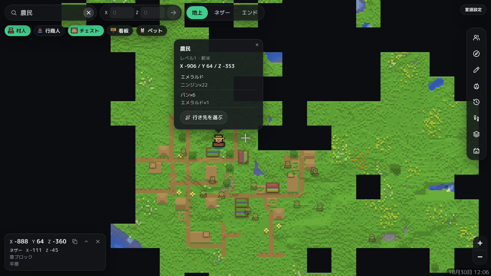

# Blockmap

[English](README.en.md)

Minecraft 統合版の Realm を、ブラウザで見られる地図にするツールです。地図はクラウドで自動更新され、PC を起動しておく必要はありません。



- 地図を見られるのは Realm のメンバーだけです(Microsoft アカウントでログイン)。
- 地図などのデータは、利用者自身の Cloudflare アカウントにだけ保存されます。
- GitHub と Cloudflare の無料枠で動きます。

## 特徴

- **地図**:地上・ネザー・エンドを表示。ブロック単位まで拡大でき、座標・高さ・ブロック名・バイオームを確認できます。
- **プレイヤー**:プレイ中の位置(約 20 秒ごと)、ベッド、最終死亡地点、24 時間の足あとを表示します。
- **検索**:座標、村人(職業・レベル・取引)、行商人、チェストの中身、看板、ペット、バイオームを検索できます。
- **書き込み**:ピン・テキスト・線・多角形・四角・円・楕円。ブロック単位でスナップし、メンバーと共有されます。
- **過去の地図**:保存された日の地図に戻れます。再生ボタンで変化を順に表示します。
- **重ねて表示**:等高線、スライムチャンク、チャンク線、ネザー座標の換算、開拓した人(推定)、ネザーゲートのリンク先。
- **Realms 情報**:サーバーの状態、参加人数、難易度、ゲームルール、次の支払日。
- **言語**:日本語・英語(ゲーム内の用語は公式の訳を使用)。

## 必要なもの

- Realm のオーナーの Microsoft アカウント(ワールドをダウンロードできるのはオーナーのみです)
- [GitHub](https://github.com/) アカウント(無料)
- [Cloudflare](https://dash.cloudflare.com/sign-up) アカウント(無料)

## セットアップ

所要時間は 30 分ほどです。[セットアップページ](https://tsow9.github.io/minecraft_be_livemap/setup.html)を使うと、必要な画面を順に開き、鍵も自動で作れます。手順は下と同じです。

### 1. リポジトリを作成する

1. このページ上部の **Use this template** → **Create a new repository** を選びます。
2. 公開範囲は **Public** のままにします([公開にする理由](#公開リポジトリにする理由))。
3. **Include all branches** にはチェックを入れません。

### 2. Cloudflare を準備する

1. Cloudflare のダッシュボードで **My Profile** → **API Tokens** → **Create Token** を開きます。
2. **Edit Cloudflare Workers** テンプレートを選び、権限に **Account / D1 / Edit** を追加して作成します。表示されたトークンを控えます(一度しか表示されません)。

サイトのアドレスは `https://blockmap.<サブドメイン>.workers.dev` です。サブドメインは **Workers & Pages** の画面で決められます。決めていなければ、GitHub のユーザー名をもとに自動で決まります(実行結果に表示されます)。

### 3. トークンを登録する

作成したリポジトリの **Settings** → **Secrets and variables** → **Actions** → **New repository secret** で、次を登録します。

| Name | Secret |
|---|---|
| `CLOUDFLARE_API_TOKEN` | 手順 2 のトークン |

データを暗号化する鍵は、最初の実行で自動的に作られ、Cloudflare のデータベースに保存されます。

必要な場合だけ、次も追加します。`CLOUDFLARE_ACCOUNT_ID` は **Secrets** タブ、それ以外は **Variables** タブです。

| Name | 値 |
|---|---|
| `LANGUAGE` | `en` にすると、Actions の実行結果のメッセージが英語になります(省略時は日本語) |
| `TIMEZONE` | 地図の日付に使うタイムゾーン(省略時は `Asia/Tokyo`) |
| `REALM_NAME` | Realm を 2 つ以上持っている場合:Realm の名前(マイクラの Realms の一覧に出ている名前) |
| `CLOUDFLARE_ACCOUNT_ID` | 1 つの Cloudflare のログインで、複数のアカウントに入れる場合(ほかの人のアカウントに招待されているなど):使うアカウントの ID。別々のメールアドレスで作ったアカウントなら不要です |

### 4. Realms にログインする

1. トークンを登録すると、1 分ほどで自動的にログインが始まります。すぐに始めるには、**Actions** タブの **Map site** → **Run workflow** → 緑の **Run workflow** を押します(What to do は **Sign in to Realms**)。
2. 最初はサイトを先に用意するので、2〜3 分待ちます。[セットアップページ](https://tsow9.github.io/minecraft_be_livemap/setup.html)にコードが出ます(Actions の実行中の **login** ジョブにも、枠で囲まれて出ます)。
3. コードを https://www.microsoft.com/link に入力します。
4. Realm のオーナーのアカウントでログインします(15 分以内)。ログイン後に「Minecraft for Nintendo Switch」と表示されますが、正常です([理由](#セキュリティとプライバシー))。
5. ログインが終わると、自動で地図の作成が始まります。数分後、実行結果の Summary に「サイト: https://blockmap.….workers.dev」と表示されます。
6. そのアドレスを開き、Microsoft アカウントでログインします。セットアップした人が管理者になります。

[セットアップページ](https://tsow9.github.io/minecraft_be_livemap/setup.html)では、コードの場所と地図の進み具合が自動で表示されます。

以降は自動で更新されます。

| 内容 | 間隔 |
|---|---|
| 地図 | 1 時間ごと(プレイ中はワールドが保存されるたび) |
| 参加中の人・プレイヤーの位置 | 10 分ごと(プレイ中は 20 秒ごと) |

## 公開リポジトリにする理由

**公開が必要な理由**:地図の更新と位置の確認は GitHub Actions で動きます。Actions は公開リポジトリなら無料で使い放題ですが、非公開リポジトリは月 2,000 分までです。Blockmap は 10 分ごとの確認だけで月 4,000 分ほど使うため、非公開では月の途中で更新が止まります。

**公開しても問題ない理由**:公開されるのはプログラムと、暗号化したデータだけです。

| 公開されるもの | 中身 |
|---|---|
| プログラム | このリポジトリと同じもの |
| `map-data`・`live-data` ブランチ | 暗号化されたデータ。鍵がないと読めません |
| Actions の実行記録 | 実行の成否と件数。通常の実行では、ゲーマータグや座標は出しません。サイトのアドレスは表示されますが、Realm のメンバー以外はログインできません |
| GitHub のユーザー名 | リポジトリの持ち主として表示されます |

Secrets(鍵)、Realms のログイン情報(Actions キャッシュ)、サイトの中身は公開されません。

## 使い方

### メンバーを招く

1. 右側の **管理者メニュー**(盾のアイコン)で **サイトのURLをコピー** を押し、メンバーに送ります。
2. メンバーはアドレスを開き、マイクラで使っている Microsoft アカウントでログインします。

### 管理者メニュー

| 項目 | 内容 |
|---|---|
| Realm の支払い | 支払日・料金・通貨。Realms 情報に表示されます |
| 地図に出さないもの | チェストすべて、ほかの人のペットを非表示にします(管理者を含む全員) |
| メンバーの書き込み | メンバーは最初は閲覧のみです。ピンや図形を書き込める人をここで選びます |

## セキュリティとプライバシー

- **Realms へのログイン**:Realms の API は一般公開されていないため、[prismarine-auth](https://github.com/PrismarineJS/prismarine-auth) を使い、Minecraft 公式アプリ(Nintendo Switch 版)としてログインします。多くの非公式ツールで使われている方法です。コードを入力する方式なので、パスワードは扱いません。使える範囲は Xbox Live と Realms に限られ、メール・OneDrive・支払い情報にはアクセスできません。ログイン情報は鍵で暗号化し、リポジトリの Actions キャッシュにのみ保存します。鍵は Cloudflare のデータベース(または Secret の `REALMS_CACHE_KEY`)にあります。
- **サイトへのログイン**:ゲーマータグの確認にだけ使い、Microsoft のトークンは確認後すぐに破棄します。サイトに残るのは、ログイン状態・ゲーマータグ・ハッシュ化した ID です。
- **データの保存先**:地図・チェスト・位置などは Cloudflare に保存されます。GitHub の `map-data`・`live-data` ブランチには暗号化した状態でのみ置かれます。
- **推奨**:Microsoft アカウントと GitHub アカウントの 2 段階認証を有効にしてください。Realms へのログインを無効にするには、Microsoft アカウントの **セキュリティ** → **すべての場所からサインアウト** を実行します(再開するには手順 4 をやり直します)。
- Microsoft 側の変更により、Realms からの取得が動作しなくなる可能性があります。

## トラブルシューティング

Actions の実行結果に表示されるメッセージで確認してください(`LANGUAGE` を `en` にした場合の英語のメッセージは [English の README](README.en.md#troubleshooting) を参照)。

| メッセージ | 対処 |
|---|---|
| まだ「Sign in to Realms」をしていない | 手順 4 を実行します |
| ログイン情報がありません / ログインの有効期限が切れました | 手順 4 をもう一度実行します |
| Realmが2個以上あります | `REALM_NAME` を追加します(手順 3) |
| Cloudflare の Secrets がそろっていない / アカウントが見つかりませんでした / 鍵を Cloudflare から用意できませんでした | 手順 3 のトークンと、その権限(手順 2)を確認します |
| 公開先のアドレスがわかりませんでした | Cloudflare の **Workers & Pages** でサブドメインを決めてから、地図を更新し直します |
| ブランチをこの鍵で開けませんでした | 鍵が変わっています(Cloudflare のデータベースを作り直した場合など)。そのブランチを削除すると、地図は最初から作り直されます |
| 自動更新が止まった | 公開リポジトリは、60 日間動きがないと定期実行が停止されることがあります。Actions の画面から再開します |

## 仕組み

```
Map site(.github/workflows/map.yml)
  Realms からワールドをダウンロード(tools/realms)
  → 変化がなければ終了
  → タイル・items.json などを作成(tools/render_map.py ほか)
  → 暗号化して map-data ブランチに保存(tools/vault.sh)
  → Cloudflare Worker と静的ファイルとして公開(worker/、tools/build_site.py)

Live players(.github/workflows/live.yml)
  メンバーとオンライン状態を取得 → プレイ中はワールドからプレイヤーの位置を読む
  → サイトの /api/live に送信し、暗号化して live-data ブランチにも保存
```

- `worker/worker.js`:Microsoft ログイン(PKCE)、HMAC 化した ID によるメンバー照合、ピンの保存(D1)、非表示設定の適用。
- 地図のファイルは推測できない名前のフォルダに置き、ログインしたページにだけフォルダ名を渡します。
- `tools/render_map.py`:ワールドの LevelDB を Python で読み、各列の最上部のブロックの色で描画します(陰影・水深つき)。
- ローカルで確認するには、`python tools/build_site.py <地図データ> _site` を実行し、`_site` で `python -m http.server` を起動します。

## 謝辞

- [Leaflet](https://leafletjs.com/)(BSD-2-Clause)、[Leaflet-Geoman](https://geoman.io/) free(MIT)
- [prismarine-auth](https://github.com/PrismarineJS/prismarine-auth)、[prismarine-realms](https://github.com/PrismarineJS/prismarine-realms)(MIT)
- [NumPy](https://numpy.org/)、[Pillow](https://python-pillow.org/)
- [M PLUS Rounded 1c](https://fonts.google.com/specimen/M+PLUS+Rounded+1c)(Google Fonts)
- ペットの顔、アイテム・ブロックの名前は、地図の更新時に公式の [bedrock-samples](https://github.com/Mojang/bedrock-samples) から生成します。公式の画像やテキストはこのリポジトリに含めていません。

## プライバシーポリシーと利用規約

サイトの[プライバシーポリシー](https://tsow9.github.io/minecraft_be_livemap/privacy.html)と[利用規約](https://tsow9.github.io/minecraft_be_livemap/terms.html)は、ログイン画面からも開けます。

## ライセンス

[MIT License](LICENSE)

Leaflet・Leaflet-Geoman などの同梱ライブラリは、それぞれのライセンスに従います(`vendor/` 内の LICENSE を参照)。

